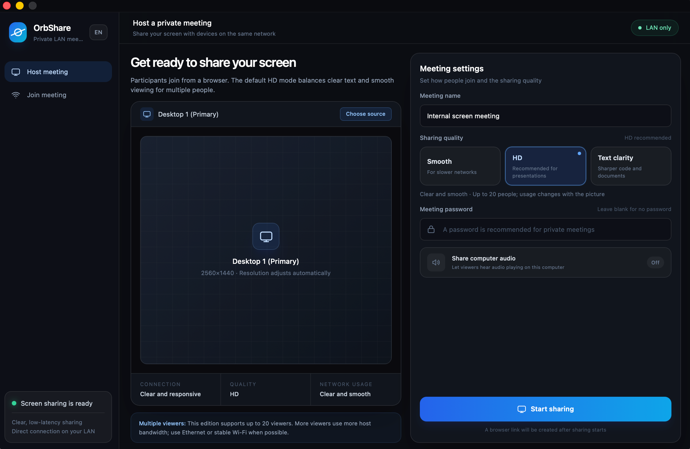
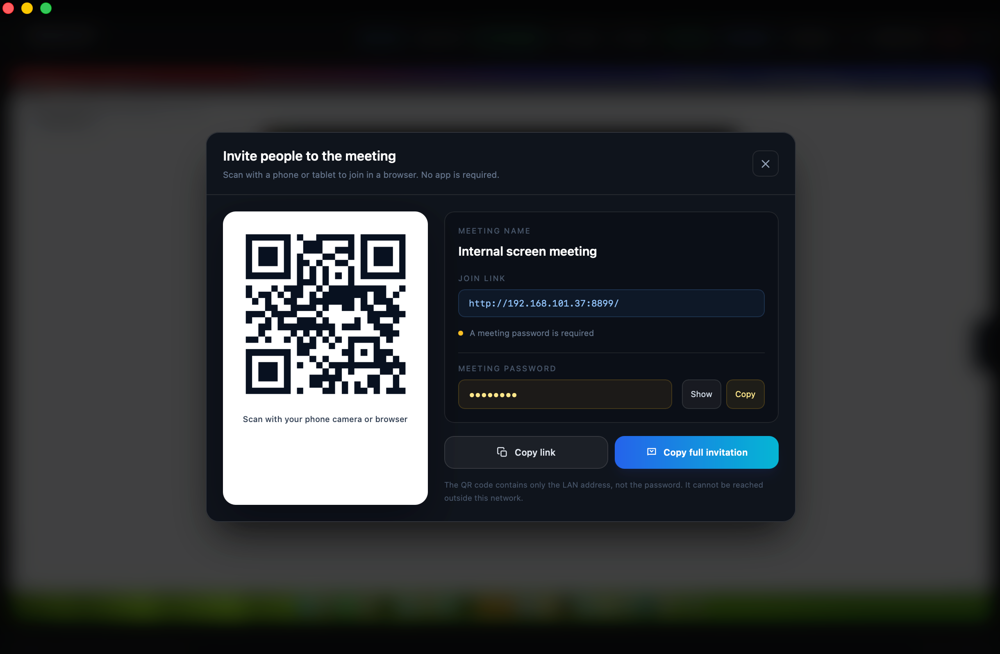
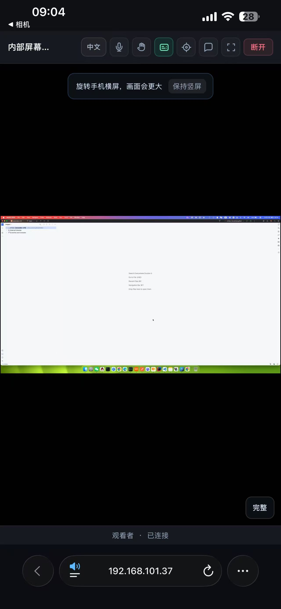

# OrbShare

<p align="center">
  <strong>Privacy-first LAN screen sharing and lightweight meetings</strong><br />
  No cloud account, no external meeting server, and browser-based joining.
</p>

<p align="center">
  <a href="README.md">简体中文</a> · English
</p>

<p align="center">
  <a href="https://github.com/JiangYanlong/orbshare/actions/workflows/ci.yml"></a>
  <a href="LICENSE"></a>
  
</p>

OrbShare captures the screen, performs hardware encoding, hosts signaling, and serves the viewer page on the host computer. Guests on the same LAN can join with an invitation link, QR code, or another OrbShare client. Screen video, audio, chat, and meeting control messages do not need to pass through an OrbShare cloud service.

> [!IMPORTANT]
> OrbShare is an actively developed `0.x` project. The current priority is reliable macOS hosting and modern-browser viewing; it should not yet be treated as an enterprise meeting product with a validated SLA.

## Screenshots



<p align="center">
  
  
</p>

See the [full screenshot gallery](docs/screenshots.md) for hosting, source selection, participant controls, recording, and mobile viewing.

## Implemented features

- Share a full desktop or an application window and switch sources during a meeting
- Low-latency H.264 + WebRTC transport with Smooth, HD, and Text clarity profiles
- Browser joining on phones, tablets, and computers
- LAN discovery, manual IP joining, invitation links, and QR codes
- Meeting passwords, participant list, raise hand, mute, and removal controls
- Public chat, common emoji, and optional on-screen comments
- Host laser pointer, system audio, and microphone transport
- Host-side local recording, automatic saving, and quick access to the output directory
- Join, leave, and rejoin timeline statistics
- Chinese and English UI with system-language detection
- macOS desktop/window capture and VideoToolbox hardware encoding

## Privacy and security boundary

OrbShare is designed to keep meeting data on the current LAN:

- No OrbShare account is required
- No OrbShare cloud service is contacted
- Media and control messages travel directly between the host and viewers
- A meeting password is retained only by the host for the active meeting
- The built-in HTTP viewer must not be exposed directly to the public internet

Any LAN device that can reach the meeting address and pass password verification may be able to view the content. Use a password and a trusted network for sensitive meetings, and stop sharing when the meeting ends.

## Platform status

| Platform | Host sharing | Native joining | Browser joining |
|---|---:|---:|---:|
| macOS 12.3+ | Primary support | Supported | Supported |
| Windows 10/11 | In development | Basic support | Supported |
| iOS / iPadOS | — | Prototype | Supported |
| Android / Linux | Planned | Planned | Modern browsers supported |

The current P2P topology sends one stream per viewer and applies a conservative 20-viewer room limit. Real capacity depends on the host CPU/GPU, upload bandwidth, quality profile, and screen activity. Load-test OrbShare on the target network before production use.

## macOS signing and notarization

This repository currently **does not provide an official download signed with Apple Developer ID and notarized by Apple**. Local builds use development or ad-hoc signing. When an unnotarized `.app` or `.dmg` is downloaded to another Mac, Gatekeeper may report that the developer cannot be verified, that the app is damaged, or that the app cannot be opened.

Recommended approach:

1. For evaluation, build the app from source on your own Mac.
2. Distributors should use their own paid Apple Developer account, a `Developer ID Application` certificate, and App Store Connect credentials to sign and notarize the build.
3. Distribute the DMG only after notarization succeeds, then verify installation and screen-recording permissions on a clean Mac.

Tauri can use `APPLE_SIGNING_IDENTITY` and Apple notarization credentials during the build. Follow the [Tauri macOS code-signing guide](https://v2.tauri.app/distribute/sign/macos/) and [Apple's notarization documentation](https://developer.apple.com/documentation/security/notarizing-macos-software-before-distribution). Never commit certificates, private keys, Apple ID passwords, or API keys.

## Quick start

### Requirements

- Node.js 22+
- Rust stable
- Xcode Command Line Tools for macOS builds
- Platform build dependencies required by Tauri 2

### Development

```bash
npm ci
npm run tauri dev
```

### Build for macOS

```bash
npm run build:mac:debug
```

Default outputs:

```text
target/debug/bundle/macos/OrbShare.app
target/debug/bundle/dmg/OrbShare_0.1.0_aarch64.dmg
```

Before the first share, allow OrbShare under **System Settings → Privacy & Security → Screen & System Audio Recording**, then quit and reopen the app completely.

### Tests

```bash
npm run build
cargo fmt --all --check
cargo test --workspace
```

Full macOS acceptance baseline:

```bash
./script/acceptance.sh
```

## Usage

1. Select a desktop or application window and choose a quality profile.
2. Optionally set a meeting password and enable computer audio.
3. Start sharing, then copy the invitation link or display the QR code.
4. Viewers join the same LAN and open the link in a browser.
5. The host can switch sources without recreating the room.

## Repository layout

```text
src/                    React / TypeScript desktop UI
src-tauri/              Tauri application and meeting orchestration
viewer/                 Bundled browser viewer
crates/orb-capture/     macOS / Windows screen capture
crates/orb-encoder/     Video encoding
crates/orb-media/       Audio/video routing and throttling
crates/orb-webrtc/      WebRTC sessions
crates/orb-signaling/   LAN signaling
crates/orb-discovery/   mDNS discovery
apps/ios/               iOS / iPadOS viewer prototype
docs/                   Architecture, acceptance, and expansion notes
```

See the [LAN meeting architecture](docs/architecture/lan-meeting-architecture.md) and [acceptance matrix](docs/acceptance/prd-v1-acceptance.md) for more detail.

## Roadmap / Not implemented yet

The following items are plans, not features in the current release.

### Stability and releases (priority)

- Long-running multi-device macOS tests and 5/10/20-viewer load tests
- Better recovery for system audio, microphones, and long recordings
- A reproducible Developer ID signing, notarization, and GitHub Release pipeline
- Crash diagnostics, network quality metrics, and a broader performance baseline

### Platforms

- Production-ready Windows capture, hardware encoding, and installer
- A complete native iOS/iPadOS viewer
- Native Android and Linux viewers
- Consistent meeting state and interaction across desktop and mobile clients

### Scale

- An optional lightweight LAN relay to reduce host upload usage for larger rooms
- Adaptive bitrate, congestion control, and per-viewer quality layers
- Compatibility testing across more routers, guest networks, and enterprise Wi-Fi environments

### Deferred

- Advanced annotation tools
- Guest-side local recording
- Public-internet cloud meetings or relay services

Roadmap items are open for discussion in Issues but are not delivery commitments.

## Contributing

Issues and pull requests are welcome. Read [CONTRIBUTING.md](CONTRIBUTING.md) before starting. Report security issues privately through **Security → Report a vulnerability** instead of publishing exploitable details.

## License

OrbShare is available under the [MIT License](LICENSE). Third-party dependencies remain subject to their respective licenses.
