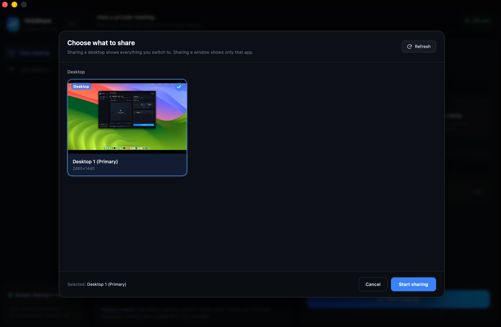
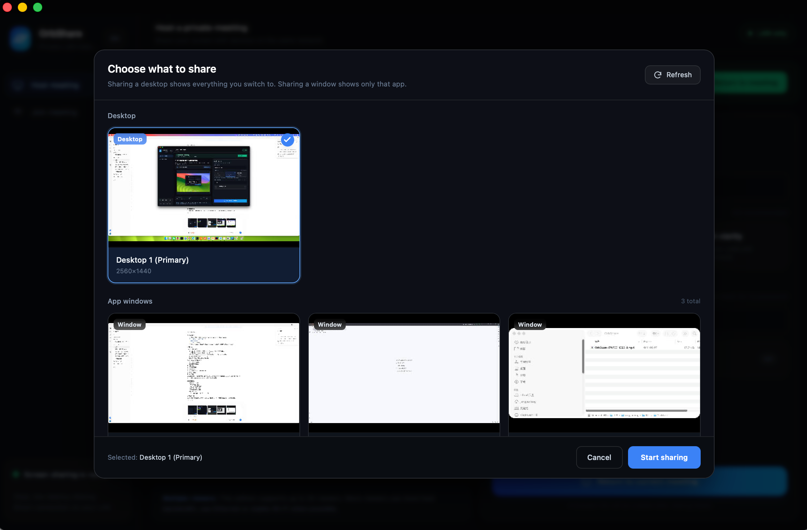
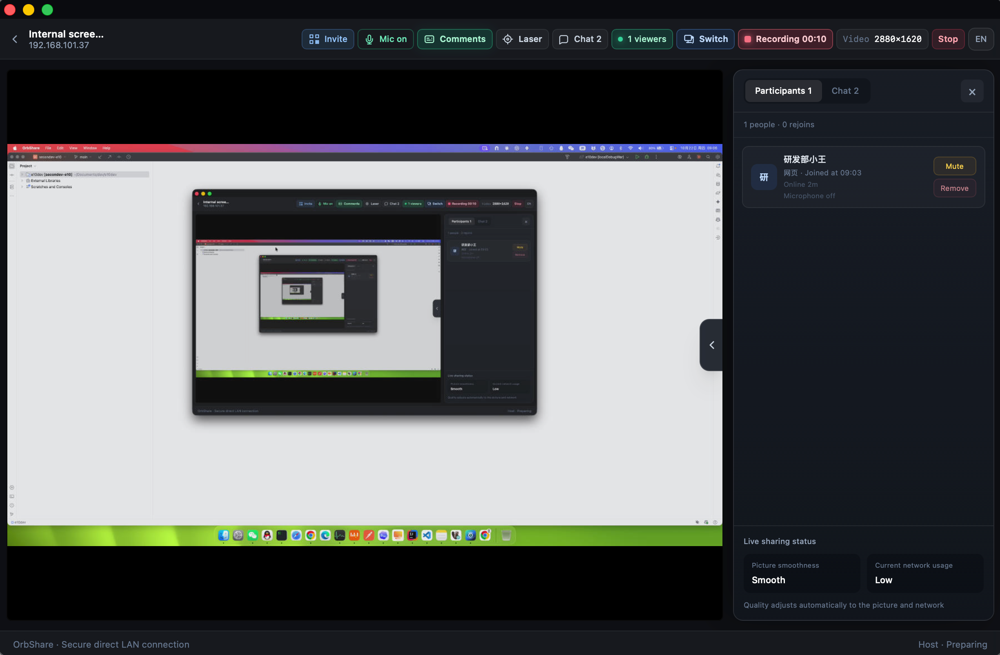
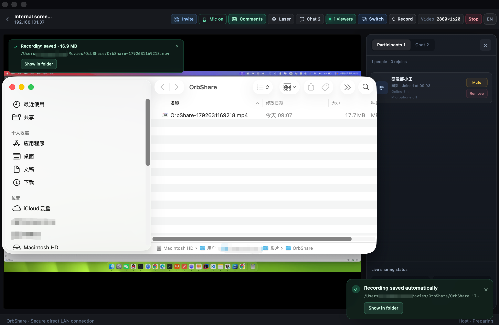
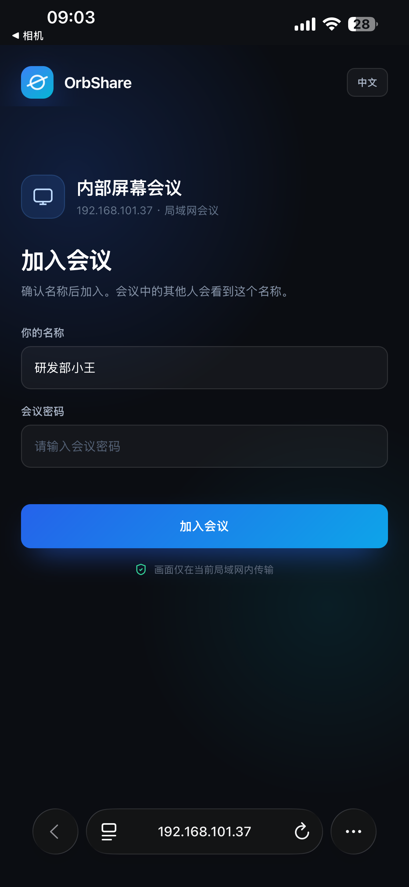
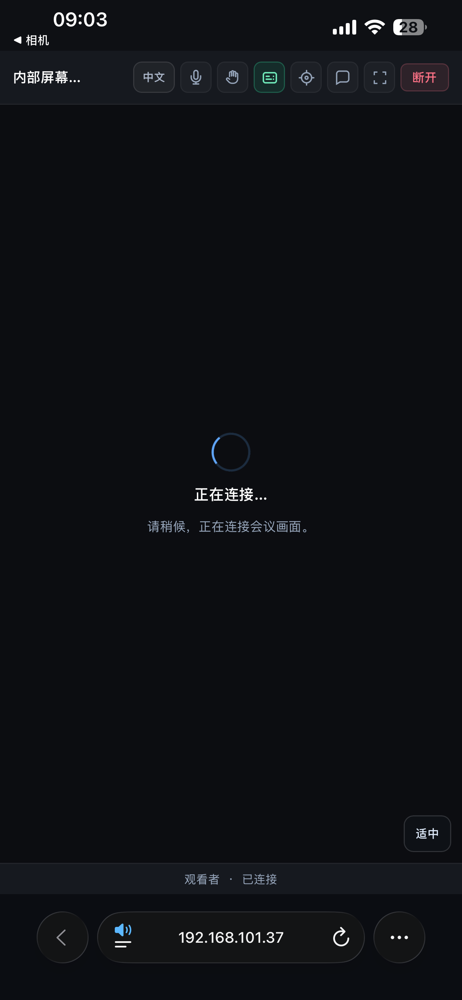
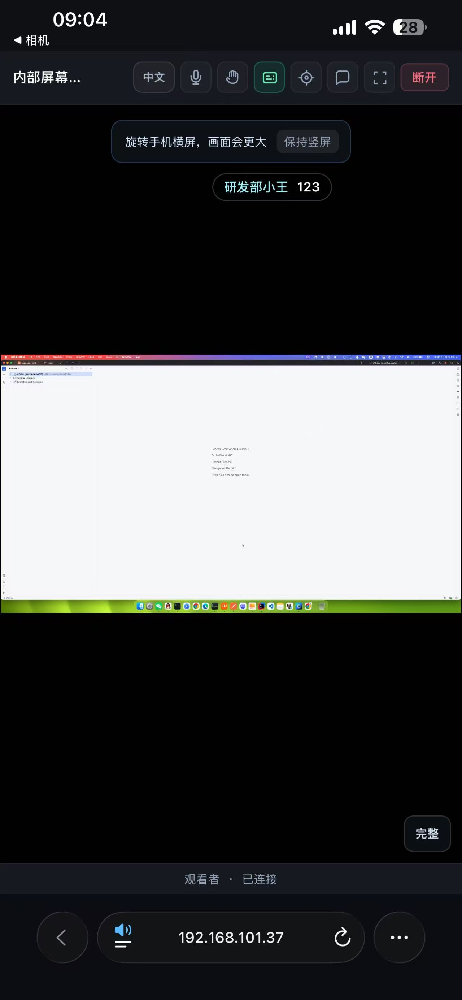

# 界面截图 / Screenshots

这组截图按 OrbShare 的实际使用流程整理：创建会议、选择共享内容、邀请成员、主持会议、本地录制，以及手机浏览器加入和观看。

These screenshots follow the OrbShare workflow: host a meeting, choose what to share, invite participants, manage the meeting, record locally, and join from a mobile browser.

> [!NOTE]
> 截图来自开发版本，界面可能随迭代调整。截图中的局域网地址仅作示例，只能由同一网络内的设备访问。
>
> Screenshots are from a development build and may change. The LAN addresses shown are examples and are reachable only from devices on the same network.

## 1. 创建会议 / Host a meeting

发起端可以设置会议名称、共享画质、可选密码和电脑声音。默认高清模式兼顾文字清晰度与多人观看时的流畅度。

The host can configure the meeting name, sharing quality, optional password, and computer audio. The default HD profile balances text clarity and smooth viewing.

## 2. 选择共享内容 / Choose what to share

选择桌面时，观看者可以看到之后切换的全部内容；选择应用窗口时，只会共享指定窗口。会议进行中也可以切换共享来源。

Sharing a desktop shows everything displayed on that desktop. Sharing an application window limits the stream to that window. The source can also be switched during a meeting.

<table>
  <tr>
    <th>选择桌面 / Select a desktop</th>
    <th>桌面与应用窗口 / Desktop and app windows</th>
  </tr>
  <tr>
    <td></td>
    <td></td>
  </tr>
</table>

## 3. 邀请成员 / Invite participants

邀请面板集中展示二维码、局域网加入链接和会议密码。手机或平板可以直接扫码，并在浏览器中加入，无需安装客户端。

The invitation panel provides a QR code, LAN join link, and meeting password. Phones and tablets can scan the code and join in a browser without installing the app.

## 4. 主持会议与本地录制 / Host controls and local recording

主持端工具栏提供麦克风、弹幕、激光笔、聊天、成员管理、共享来源切换和本地录制。成员面板可查看在线状态并执行禁言或移除操作。

The host toolbar includes microphone, on-screen comments, laser pointer, chat, participant management, source switching, and local recording. The participant panel shows presence and provides mute and removal controls.

<table>
  <tr>
    <th>成员管理与录制 / Participants and recording</th>
    <th>录制自动保存 / Recording saved automatically</th>
  </tr>
  <tr>
    <td></td>
    <td></td>
  </tr>
</table>

录制结束或共享停止时，视频会保存到本机，并可通过“在文件夹中显示”直接打开保存位置。

When recording ends or sharing stops, the video is saved locally and its location can be opened with **Show in folder**.

## 5. 手机浏览器加入 / Join from a mobile browser

观看者在加入页填写名称和会议密码，随后进入连接状态。整个过程只需要浏览器和当前局域网连接。

Viewers enter a display name and meeting password, then proceed through the connection state. Only a browser and access to the current LAN are required.

<table>
  <tr>
    <th>加入会议 / Join the meeting</th>
    <th>建立连接 / Connecting</th>
  </tr>
  <tr>
    <td align="center"></td>
    <td align="center"></td>
  </tr>
</table>

## 6. 手机观看与弹幕 / Mobile viewing and on-screen comments

竖屏观看时会提示旋转到横屏以获得更大的画面，也可以继续保持竖屏。弹幕开启后，聊天消息会覆盖显示在共享画面上。

In portrait mode, OrbShare suggests rotating to landscape for a larger picture while still allowing portrait viewing. When on-screen comments are enabled, chat messages appear over the shared content.

<table>
  <tr>
    <th>竖屏观看 / Portrait viewing</th>
    <th>弹幕消息 / On-screen comment</th>
  </tr>
  <tr>
    <td align="center"></td>
    <td align="center"></td>
  </tr>
</table>

---

[返回中文 README](../README.md) · [Back to English README](../README.en.md)
